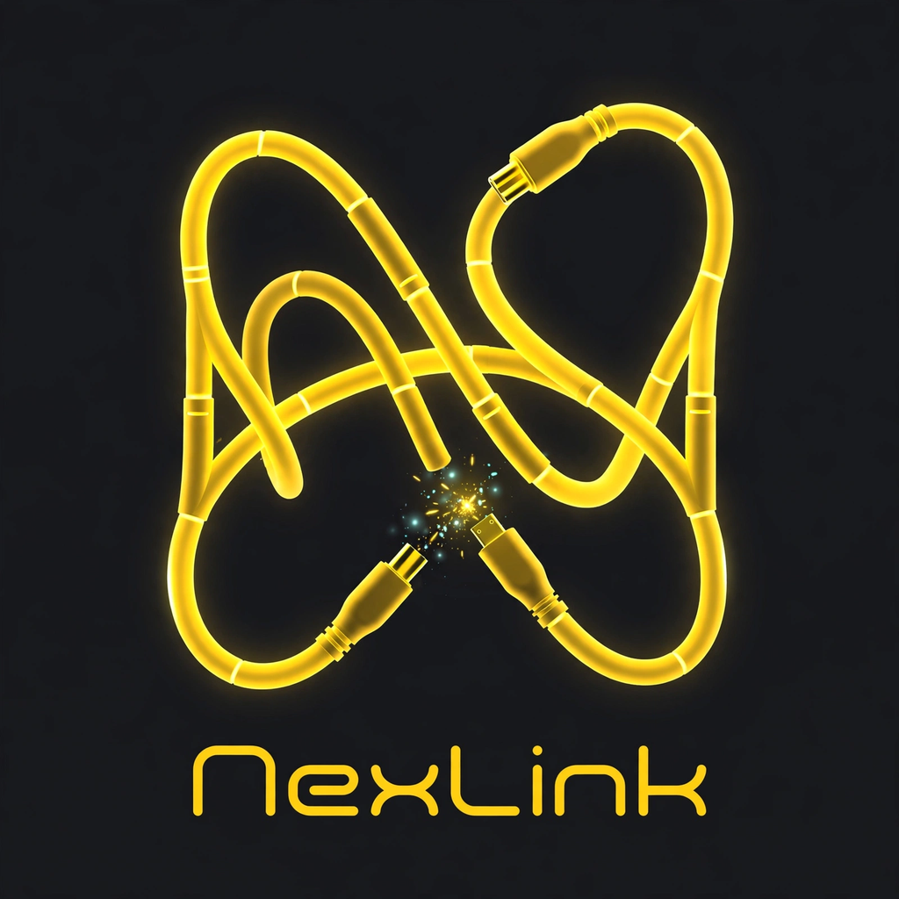

<p align="center">
  
</p>

# NexLink

**Share your phone's internet with your PC — VPN, DNS and all — over USB, Wi-Fi or Bluetooth.**

Standard tethering and hotspot route your PC's traffic *around* your phone's
VPN. NexLink doesn't: the phone app re-originates every connection with its
own sockets, so your PC traffic exits through the phone's VPN tunnel and the
phone's DNS, exactly like the phone's own apps.

And unlike proxy-based tools, NexLink installs a **real virtual network
adapter** (Wintun) on Windows. No proxy settings are ever touched, so every
app on the PC just works.

## The rules it is built on

- 🔌 **USB first** (via ADB forwarding, like PdaNet+), Wi-Fi and Bluetooth after.
- 🛡️ **VPN & DNS ride along** — guaranteed by design, not by a settings toggle.
- 🚫 **No proxy.** Not on the PC, not anywhere.
- 🖱️ **Manual connect.** One Connect button in the system tray. No auto-retry loops.
- 📱 **The phone decides.** A small Android companion app has an
  *"Allow connection"* switch that can only be armed while USB / Bluetooth /
  Wi-Fi is actually connected. Nothing connects until both sides say so.
- 🪶 **Tiny footprint.** The PC side lives in the notification tray
  ("Show hidden icons") with one small settings window. That's it.

## How it works

```
PC app ──► Wintun adapter ──► user-space TCP/IP stack ──► flows ══USB/Wi-Fi/BT══► phone app ──► phone sockets ──► phone network / VPN
```

Full design: [ARCHITECTURE.md](ARCHITECTURE.md)

## Status

🚧 **In development.** The core data path (virtual adapter → stack → wire
protocol → phone-side relay) is implemented and covered by an end-to-end
test with a simulated phone. The Windows tray app now connects for real:
after the phone check it opens the Wintun adapter, installs the tunnel
routes and runs the engine, and Disconnect (or quitting) tears it all
down. It ships as an NSIS installer (built by CI on every push to main)
that bundles `wintun.dll` and `adb.exe` next to the exe, asks Windows for administrator
rights at launch via its app manifest, and offers a "Start with Windows"
checkbox in the settings window.

**USB mode needs USB debugging on the phone:** enable Developer options → USB debugging, plug the phone in, arm "Allow connection" in the NexLink app, and accept the "Allow USB debugging" prompt on the phone when it appears. Since v0.2.1 the installer also bundles `adb.exe` (with its DLLs), so no separate ADB install is needed.

Still to come: the Bluetooth dialer on
the PC side; see the roadmap in [ARCHITECTURE.md](ARCHITECTURE.md).

**Running it (Windows):** install from the NSIS installer — the app
elevates itself via a UAC prompt, because creating the virtual adapter
and changing routes need administrator rights. (A hand-built exe still
needs right-click → Run as administrator.) With "Start with Windows" on,
expect a UAC prompt at each logon — a Task Scheduler entry would avoid
that, and is a later improvement.

**Download:** the latest release (v0.3.1) — installer + APK: https://github.com/rconpilot/NexLink/releases/tag/v0.3.1

## Repository layout

| Path | What |
|------|------|
| `pc/crates/nxcore` | Wire protocol, user-space stack, relay engine (Rust) |
| `pc/crates/nxpump` | CLI harness that binds the engine to a TUN/Wintun device |
| `pc/crates/simphone` | A simulated phone relay, used by the end-to-end test |
| `pc/app` | Windows tray app (Tauri) |
| `android` | Android companion app (Kotlin) |

## License

MIT — see [LICENSE](LICENSE).
